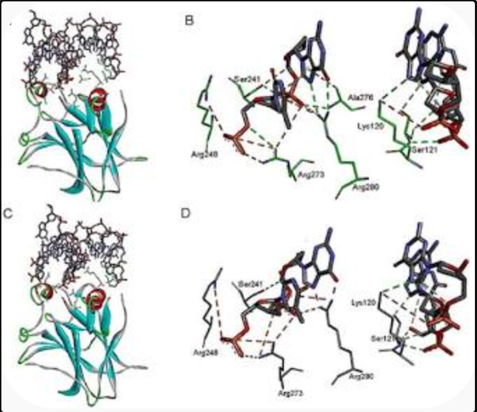
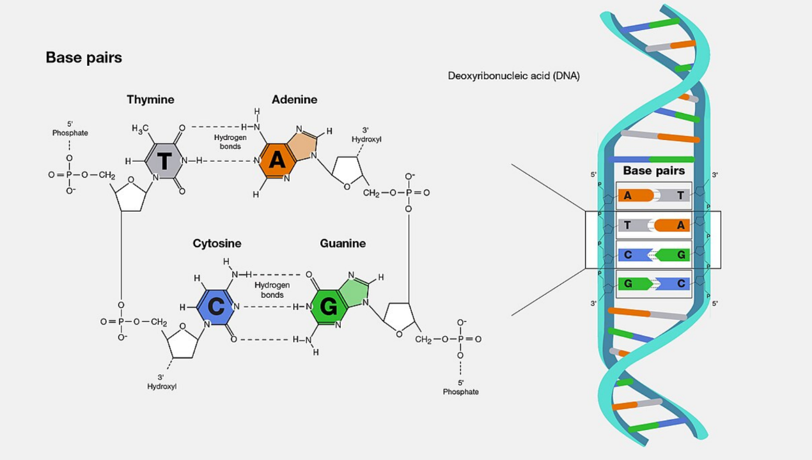
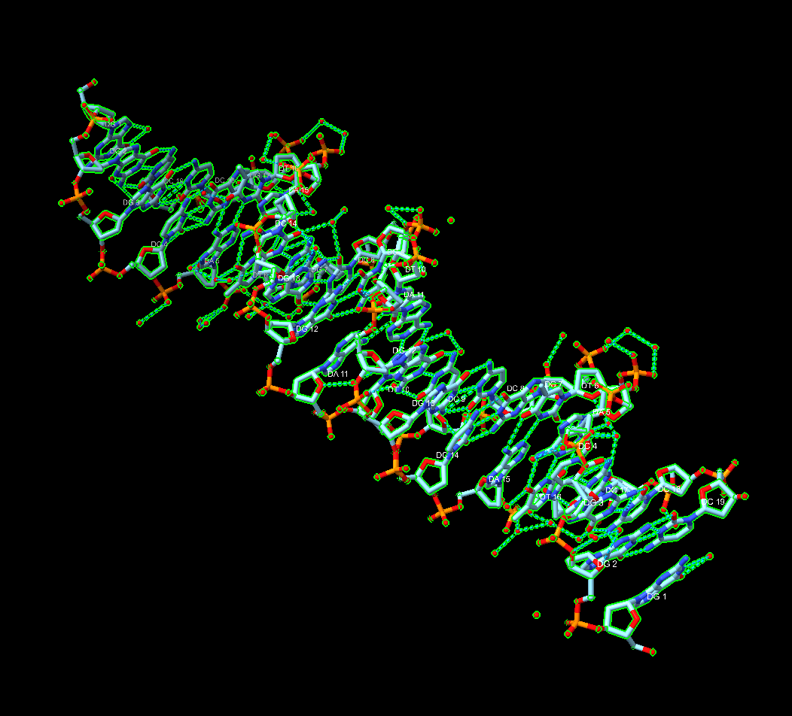

# Scientist's Mission(0153B031,黃珈敏)

chiamin31/0153B031: 2026/10/12

## Who Stole TP53's Superpower? Searching for the Key to Unlock Cancer

*Using AI to Uncover the Secrets of TP53--DNA Interactions*

## 1. 【The LEGO Assembly Line】

What type of bond links amino acids together to form a protein? Which
amino acids form hydrogen bonds with each other?

### Answer:

#### 1. The Bond Linking Amino Acids

Amino acids are linked together to form a protein by peptide bonds (also
known as amide bonds). These covalent bonds are formed through a
dehydration (condensation) reaction between the carboxyl group () of one
amino acid and the amino group () of the next.

#### 2. Hydrogen Bonds in TP53 (Tumor Protein p53)

When examining hydrogen bonding in the TP53 protein, interactions occur
in two main contexts: internal structural stabilization within the
protein itself and protein-DNA interactions when p53 binds to target
genes as a transcription factor.

#### A. Internal Structural Hydrogen Bonds (Stability)

Within p53's central DNA-binding domain (DBD) and its oligomerization
domain, hydrogen bonding network systems maintain the tertiary and
quaternary structure:

-   Sheet and -Helix Stabilization: Backbone carbonyl oxygens and amide
    hydrogens form regular hydrogen bonds to create the -sandwich
    scaffold and loops (such as Loop 1, Loop 2, and Loop 3) that
    characterize the core domain.

Specific Stabilizing Residues: Residues like Asn268 form critical
hydrogen bonds with neighboring residues (such as Arg267 and Phe109) to
bridge structural sheets and maintain thermodynamic stability.
Similarly, Arg282 participates in a network of hydrogen bonds that
stabilizes the crucial loop-sheet-helix motif. Mutations disrupting
these hydrogen-bonding networks often destabilize the protein, which is
a common hallmark in cancer-associated variants.

PMC - NIH+ 1

#### B. Hydrogen Bonds with DNA (Functional Binding)

As a sequence-specific transcription factor, wild-type p53 relies
heavily on amino acid side-chain hydrogen bonds to "read" and bind
specific DNA sequences:

Contact Residues: Key amino acids in the DNA-binding loops---most
notably Arg248, Arg273, and Lys120---form direct hydrogen bonds and
electrostatic interactions with the DNA bases and the sugar-phosphate
backbone, enabling p53 to regulate target gene expression.

## 2. 【The Double-Track Highway of Life's Blueprint】

How do nucleotides assemble to form double-stranded DNA? What are the
basic structural components of DNA? Is DNA right-handed or left-handed?
List the names of the four DNA bases. Which bases form hydrogen bonds
with each other?

### Answer:

#### 1. Basic Structural Components of DNA

A DNA molecule is a polymer made up of repeating units called
nucleotides. Each individual nucleotide consists of three core
components:

A 5-Carbon Sugar: Deoxyribose.

A Phosphate Group: Attached to the 5' carbon of the sugar.

A Nitrogenous Base: Attached to the 1' carbon of the sugar.

#### 2. Assembly into Double-Stranded DNA

Nucleotides assemble into a double-stranded helix through two main types
of linkages:

Single-Strand Assembly (Phosphodiester Bonds): Nucleotides join together
through covalent phosphodiester bonds between the 3'-hydroxyl group of
one sugar and the 5'-phosphate group of the next, creating a strong
sugar-phosphate backbone with a distinct 5' to 3' directionality.

Double-Strand Assembly (Hydrogen Bonds & Antiparallel Alignment): Two
single strands come together in an antiparallel orientation (one runs 5'
to 3', and the complementary strand runs 3' to 5'). Their nitrogenous
bases point inward and bind to each other through hydrogen bonds,
stabilizing the twisted double-helix structure.

#### 3. Handedness of DNA

The most common biological form of DNA (known as B-DNA) is right-handed.
When looking down the axis of a B-DNA double helix, the strands spiral
clockwise and away from the viewer. (Note: Rare forms like Z-DNA can
adopt a left-handed helix under specific cellular conditions, but
standard genomic DNA is right-handed).

#### 4. The Four DNA Bases

The four nitrogenous bases found in DNA are:

Adenine (A)

Thymine (T)

Cytosine (C)

Guanine (G)

#### 5. Base Pairing and Hydrogen Bonds

Because of the chemical structure and spatial fit of the bases, they
pair up specifically through complementary hydrogen bonding:

Adenine (A) always pairs with Thymine (T), held together by 2 hydrogen
bonds.

Cytosine (C) always pairs with Guanine (G), held together by 3 hydrogen
bonds.

## 3. 【Searching for My One-and-Only Soulmate in the Universe: A 20-Base-Pair Love Code Hidden Among 3 Billion DNA Base Pairs】

The source of molecular stability and specificity: hydrogen bonding ---
How do TP53 and DNA recognize each other?

Using the structure 3KMD, identify one pair of an amino acid and a DNA
base that interact with each other.

### Answer:

How TP53 and DNA Recognize Each Other

The sequence-specific recognition between the tumor suppressor protein
TP53 and its target DNA sequences relies heavily on a precise network of
hydrogen bonds and van der Waals interactions.

Major and Minor Groove Insertion: The p53 DNA-binding domain (DBD)
features specialized structural loops and an -helix that insert directly
into the major and minor grooves of the DNA double helix.

Direct Base Readout: Amino acid side chains project into the interior of
the grooves to form specific hydrogen bonds with the chemical groups
exposed by the nitrogenous bases (Adenine, Thymine, Cytosine, and
Guanine), allowing p53 to "read" the correct DNA sequence without
unwinding the double helix.

Interacting Pair in Structure 3KMD

In crystal structures of p53 bound to DNA consensus sequences (such as
PDB ID 3KMD):

Amino Acid: Arginine 280 (Arg280) (or alternatively Arginine 273)

DNA Base: Guanine (G)

Interaction Details:

Arg280 (located in the DNA-binding helix of the p53 core domain) extends
into the major groove of the DNA double helix and forms stable, specific
hydrogen bonds with the invariant Guanine bases. This direct
hydrogen-bonding interaction is critical for target recognition and
binding affinity; mutations at this site (common in cancers) disrupt
these hydrogen bonds and abolish p53's ability to regulate target genes.

## 4. 【Return to the Crime Scene】

Why can a mutation (change) in just one amino acid of a protein
sometimes lead to a serious human disease? Give one specific example of
such a disease.

### Answer:

## 5. 【Return to the Crime Scene: Searching for Clues】

Using the TP53--DNA structure (3KMD), identify one TP53 amino acid
mutation that can lead to uncontrolled cell division and contribute to
the development of cancer.

Then examine this amino acid in ChimeraX. Based on its three-dimensional
position, determine whether the mutated amino acid is located directly
at the protein--DNA interface or somewhere else in the protein.

### Answer: 1. Identified TP53 Cancer Hotspot Mutation

One of the most frequently mutated and clinically significant amino acid
positions in the TP53 tumor suppressor is Arginine 273 (Arg273). In
human cancers, this residue is commonly substituted via missense
mutations into Histidine (R273H) or Cysteine (R273C).

Because wild-type Arg273 is essential for anchoring p53 to its target
DNA sequences, substituting it with a different amino acid abolishes
sequence-specific DNA binding. This halts transcription of cell-cycle
arrest and apoptosis genes, allowing damaged cells to proliferate
unchecked and driving tumorigenesis.

#### 2. Examination in ChimeraX (3D Position in Structure 3KMD)

When viewing the crystal structure 3KMD in molecular visualization
software like UCSF ChimeraX:

Side-Chain Orientation: The long, positively charged guanidinium side
chain of Arg273 projects outward from the DNA-binding loop/helix motif
of the p53 core domain.

Proximity to DNA: In the 3D coordinate space, the side chain is
positioned immediately adjacent to the nucleic acid chains, physically
interlocking with the DNA minor groove and backbone.

#### 3. Interface vs. Core Location

Based on its three-dimensional position, Arg273 is located directly at
the protein--DNA interface.

Why it matters: Contact residues like Arg273 (along with other hotspots
like Arg248 and Lys120) are specialized "reader" residues. Because they
sit squarely at the binding boundary rather than buried inside the
hydrophobic core of the protein, any chemical alteration here
immediately sabotages the physical and electrostatic handshake required
for p53 to recognize and bind DNA.

#### 1. What Happens Chemically (At the Interface)

Wild-Type State (Arg273): In a healthy cell, the long, positively
charged side chain of Arginine 273 projects from the DNA-binding surface
to form a stable electrostatic and hydrogen-bonding "handshake" with the
DNA backbone and bases.

Mutant State (His273): Histidine has a shorter, aromatic imidazole ring
instead of a long flexible guanidinium chain.

The Result: The side chain can no longer reach or form the precise
hydrogen bonds required to lock onto the DNA. The physical anchor at the
protein-DNA interface is lost.

#### 2. Downstream Biological Consequence

Because sequence-specific DNA binding is abolished:

Loss of Tumor Suppression: The mutant p53 protein can no longer activate
protective target genes like CDKN1A (p21), which normally stops the cell
cycle to allow DNA repair. Damaged cells continue to replicate.

Gain-of-Function (GOF): Beyond just losing its normal job, the R273H
variant actively promotes cancer malignancy. For example, in non-small
cell lung cancer (NSCLC) and esophageal squamous cell carcinoma, the
R273H mutant upregulates migration-associated genes (such as NEU1),
driving tumor invasion, metastasis, and therapeutic resistance.

-   Paste a screenshot of your ChimeraX visualization here.

b.  Save your ChimeraX session file as StudentID.cxs.
